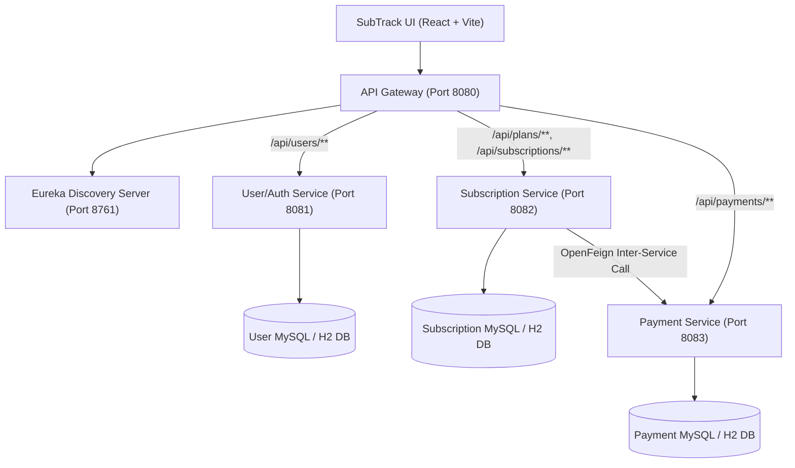
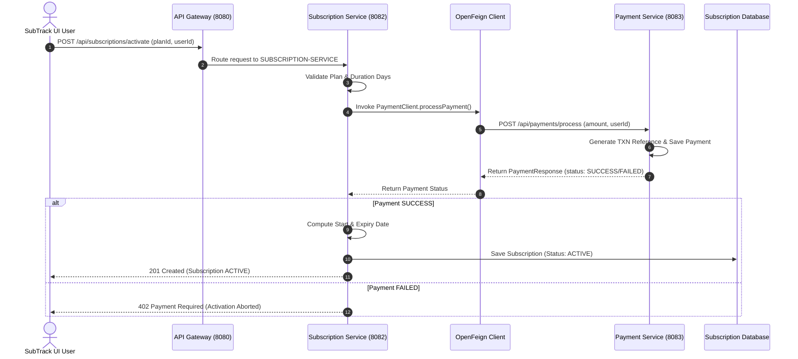
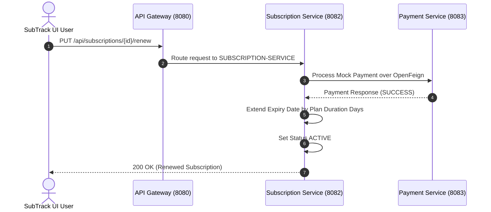
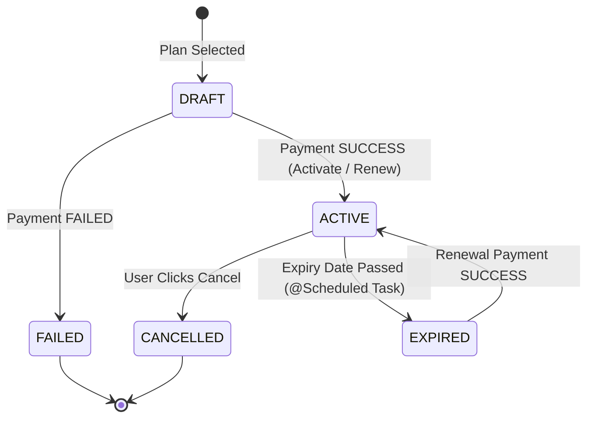
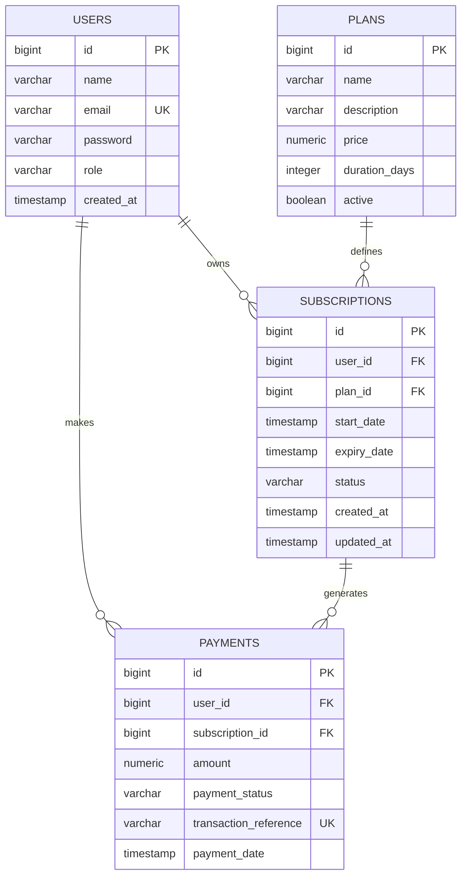

# SubTrack – Architecture Documentation

**Project Identity**: SubTrack – Subscription Lifecycle & Recurring Revenue Management System  
**Architecture Pattern**: Microservices Architecture / Service-Oriented Architecture (SOA)

---

## 1. System Architecture Overview

SubTrack is built using a modern Spring Cloud Microservices pattern. All client requests pass through a single entry point—the **Spring Cloud API Gateway**—which routes traffic dynamically to backend microservices using **Netflix Eureka Service Discovery**.

---

## 2. Microservice Descriptions

### 2.1 Eureka Server (`eureka-server` — Port 8761)
Acts as the central service registry. Microservices register their hostname, IP, and port dynamically.

### 2.2 API Gateway (`api-gateway` — Port 8080)
Provides single entry point, CORS headers for React UI, and route matching (`lb://USER-SERVICE`, `lb://SUBSCRIPTION-SERVICE`, `lb://PAYMENT-SERVICE`).

### 2.3 User/Auth Service (`user-service` — Port 8081)
Manages user accounts, BCrypt password hashing, JWT token generation (`JwtUtil`), and user profile lookup.

### 2.4 Subscription Service (`subscription-service` — Port 8082)
Core business service managing subscription plans, user subscriptions, activation flow, renewal, cancellation, and `@Scheduled` background expiry detection.

### 2.5 Payment Service (`payment-service` — Port 8083)
Processes mock payment transactions, generates unique transaction references (`TXN-...`), and stores payment logs.

---

## 3. Core Architectural Sequence Diagrams

### 3.1 Subscription Activation Sequence Diagram

### 3.2 Subscription Renewal Sequence Diagram

---

## 4. Subscription Lifecycle State Diagram

---

## 5. Database ERD (Entity Relationship Diagram)

